<div align="center">

<a href="https://drive.google.com/file/d/1sM2GhKTrmnHkojWA4kJU5ybNCBuHza0F/view?usp=sharing">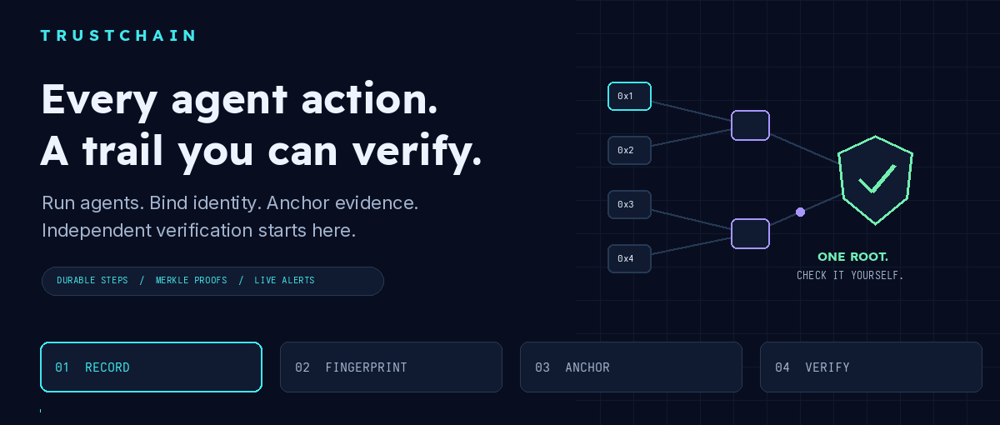</a>

# Intelligence, with a proof.

**Your agents move fast. Know what they did.**

TrustChain brings agent identities, recorded actions, on-chain evidence, and independent verification into one workspace. Run the four-agent research pipeline or instrument your existing application with the Python or TypeScript SDK. Follow the work from the first query to the final report—and from an individual step to its confirmed proof.

[▶ Watch the new cinematic demo · 5:26](https://drive.google.com/file/d/1sM2GhKTrmnHkojWA4kJU5ybNCBuHza0F/view?usp=sharing) · [Explore the design](#the-evidence-observatory) · [See it working](#see-it-working) · [Architecture](#architecture) · [Use the SDK](#instrument-your-own-agent) · [Run locally](#run-locally) · [Verification](#verified-against-the-running-system)

<sub>Espresso brown · warm white · green · responsive workspace · cinematic motion · reduced-motion support</sub>

</div>

---

## The idea in 30 seconds

An answer does not tell you which agent configuration produced it, what happened along the way, or whether its audit record changed afterward. TrustChain keeps those questions connected to evidence.

| Question | What you can inspect |
|---|---|
| **What happened?** | A saved run, ordered agent activity, source links, and a final report |
| **Which agent was involved?** | Registered configuration fingerprints and identity-bound activity when a fingerprint is supplied |
| **Has the record changed?** | Input/output content hashes, Merkle leaves, sibling paths, and roots |
| **What is confirmed?** | Per-step anchor states, transaction receipts, and block references |
| **What needs review?** | Integrity findings, expected/presented fingerprints, investigation notes, and alert history |

**Two ways in. One evidence system.**

- **Run the built-in workflow:** Researcher → Validator → Scorer → Reporter, with live activity, a cited report, and observed agent scores.
- **Connect an existing agent:** register its fingerprint and log activity from your own runtime through an SDK. TrustChain does not need to host that agent.

A proof checks correspondence to recorded evidence. A trust score reflects a pipeline evaluation. Neither guarantees that an AI-generated statement is true.

---

## See it working

<div align="center">

<a href="https://drive.google.com/file/d/1sM2GhKTrmnHkojWA4kJU5ybNCBuHza0F/view?usp=sharing">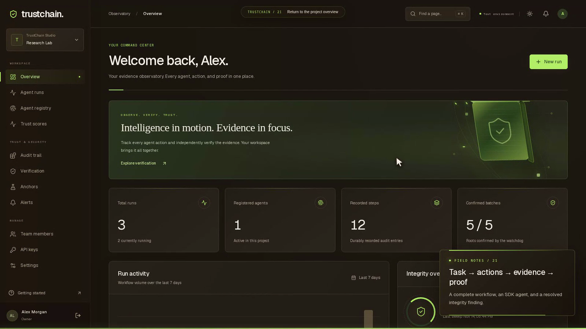</a>

**[▶ Watch the new silent product film · 5 min 26 sec · 1080p](https://drive.google.com/file/d/1sM2GhKTrmnHkojWA4kJU5ybNCBuHza0F/view?usp=sharing)**

<sub>21 chapters · animated field-note cards · chapter labels · visible cursor and click ripples · zero audio tracks</sub>

</div>

The film records the **real production frontend** with real model/search calls, PostgreSQL, Redis, both MCP servers, V2 contracts on local Anvil chain `31337`, and the anchor/indexer/watchdog services. The callouts explain the action; they do not fabricate application results. The disposable integration key is masked during capture and revoked before the film ends.

| Time | Follow the workflow |
|---|---|
| **00:00** | Landing page, four-agent explorer, and interactive SHA-256 integrity example |
| **00:34** | Enter the workspace and create a project |
| **00:57** | Launch research, watch live activity, and read the final report |
| **01:58** | Compare trust scores; search and export the audit trail |
| **02:26** | Inspect confirmed transactions, retrieve a Merkle proof, and verify the run |
| **03:12** | Create a scoped key and connect a real SDK agent |
| **03:48** | Check fingerprints and verify original content |
| **04:18** | Investigate and resolve actual identity drift |
| **04:46** | Invite a teammate and save preferences |
| **05:08** | Revoke the integration key and confirm HTTP 401 rejection |

[Full chapter list](artifacts/redesign/cinematic-tour-chapters.md) · [Video metadata](artifacts/redesign/cinematic-tour-metadata.json) · [Final report PDF](artifacts/redesign/TrustChain-Redesign-Final-Report.pdf) · [Detailed report](artifacts/redesign/final-report.md)

<table>
<tr>
<td width="50%" align="center">

**The result → the scores**

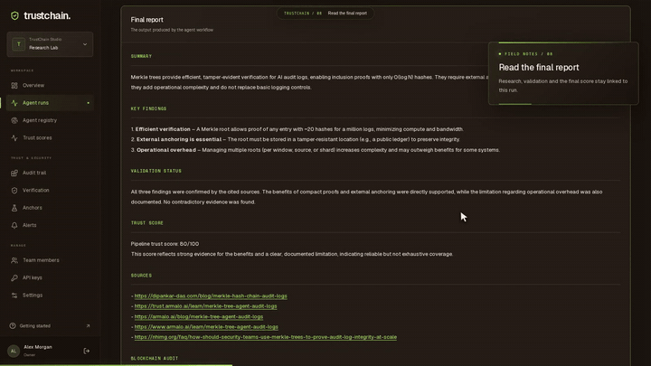

<sub>A completed workflow becomes a report, observed scores, and a saved trace.</sub>

</td>
<td width="50%" align="center">

**The step → the proof**

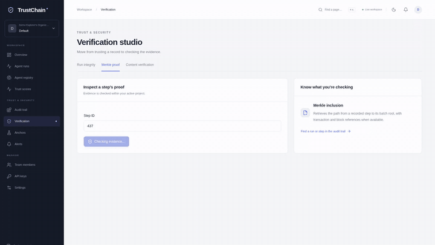

<sub>Inspect the leaf, root, sibling path, transaction, and block.</sub>

</td>
</tr>
</table>

The recorded run produced **10 confirmed audit steps**. The 325.7-second MP4 is H.264 at 1920×1080 and 30 fps, with no audio stream and fast-start metadata. The recording used `openai/gpt-oss-20b`; model selection remains configurable. Console email enabled account verification and invitation workflows. [Media provenance](assets/readme/media-provenance.json) records every excerpt's source hash and timing.

---

## The evidence observatory

The redesign carries one visual system from the first visit through the final proof: **espresso surfaces, warm white typography, and green signals**. The landing page introduces the evidence model; the workspace makes it inspectable.


### Every workspace area, connected

| Area | What you can do |
|---|---|
| **Overview** | See actual runs, registered agents, recorded steps, batch coverage, recent workflows, and shortcuts |
| **Agent runs** | Start a task, follow recorded activity, reopen its report, search/filter history, and export runs |
| **Agent registry** | Register configurations, search identities, inspect fingerprints, and test a match or mismatch |
| **Trust scores** | Compare average and best observed scores, review run counts, and export performance data |
| **Audit trail** | Search agents/actions/runs, filter anchor status, paginate, export JSON, and inspect a step |
| **Verification studio** | Check run integrity, retrieve/export Merkle proofs, and compare original content to recorded hashes |
| **On-chain anchors** | Inspect the active evidence chain and confirmed transaction groups |
| **Alerts** | Filter findings, inspect evidence, add notes, acknowledge, resolve, and reopen investigations |
| **Team members** | Invite teammates, choose roles, manage invitations, change access, and remove members |
| **API keys** | Create scoped project credentials, copy once, and revoke access |
| **Settings** | Manage organizations/projects, switch environments, choose appearance, and save notification preferences |
| **Getting started** | Follow the path from a first agent to a first proof |

### Motion with a purpose

- An animated dimensional evidence sculpture, orbital paths, and scrolling reveals introduce the landing page.
- A keyboard-operable four-stage explorer explains Researcher, Validator, Scorer, and Reporter.
- The integrity lab computes SHA-256 locally: alter the example, see the fingerprint change, then restore it. It is explicitly an illustration; live chain proofs are in the workspace.
- Page entrances, chart growth, dialog transitions, focus treatments, and hover responses carry the visual language across the dashboard and account screens.
- Dark mode is the default. A saved light-mode preference uses the complementary warm white, brown, and green palette. Motion can be paused and respects system reduced-motion preferences.
- Responsive navigation and panel-contained table scrolling keep the workspace usable on narrow screens.

<details>
<summary><b>Open the redesigned product gallery</b> — real reports, proofs, identities, and findings</summary>
<br>

| Cited research report | Observed agent performance |
|---|---|
| 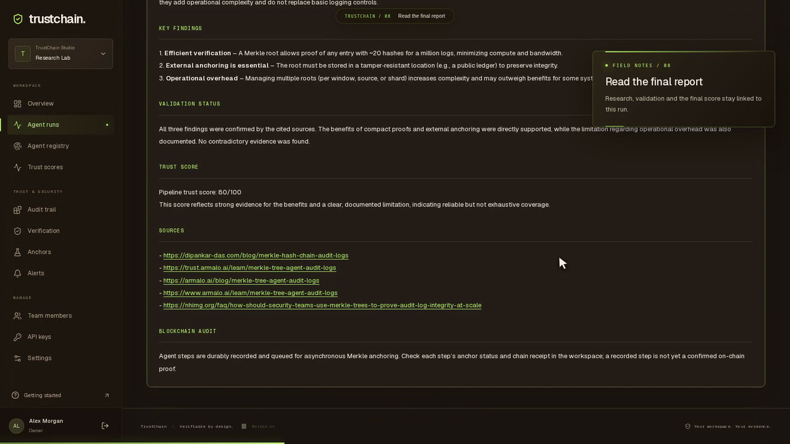 | 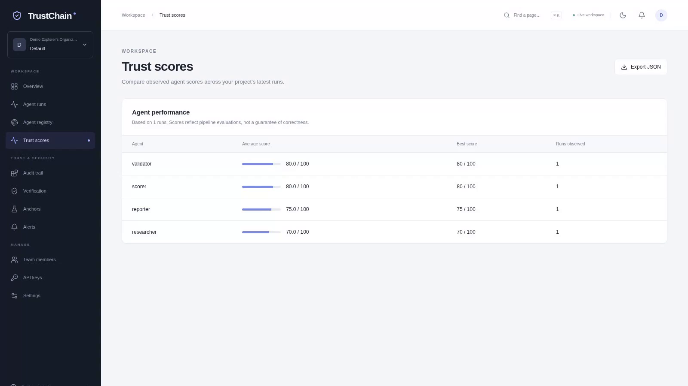 |

| Registered SDK identity | A changed fingerprint |
|---|---|
| 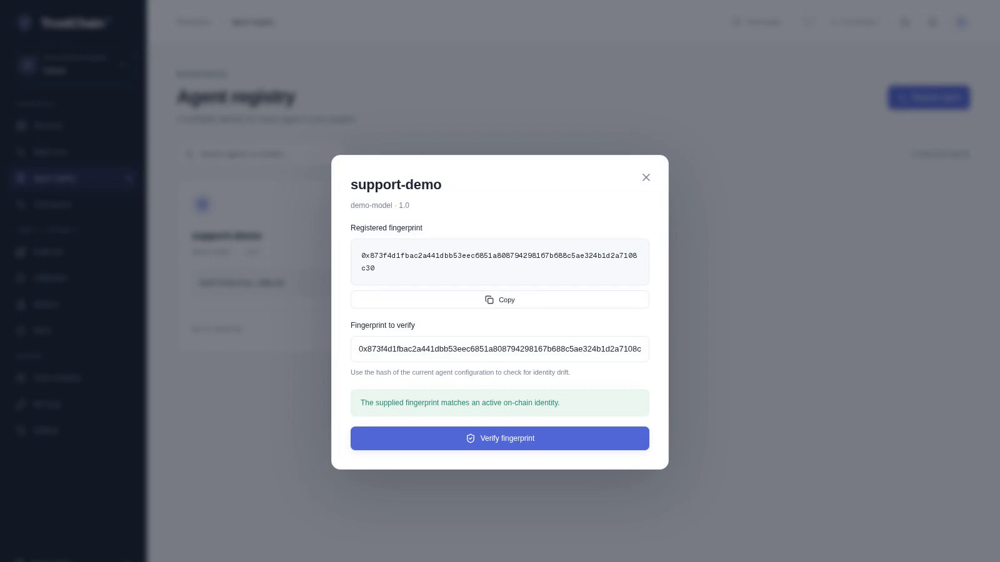 | 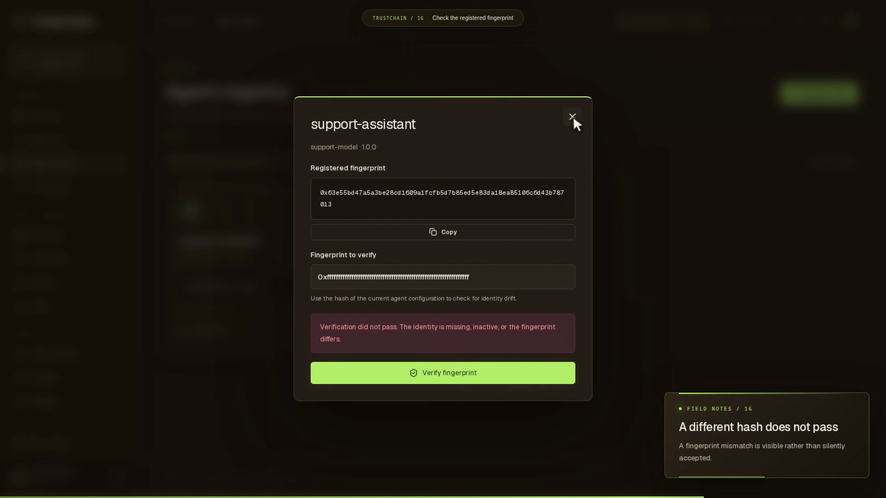 |

| Confirmed Merkle proof | Resolved investigation |
|---|---|
| 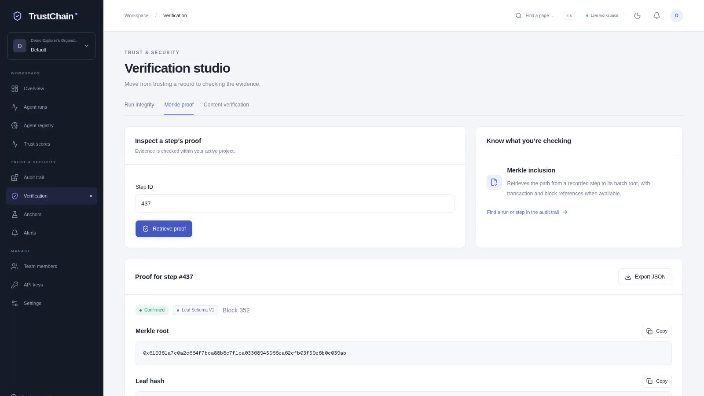 | 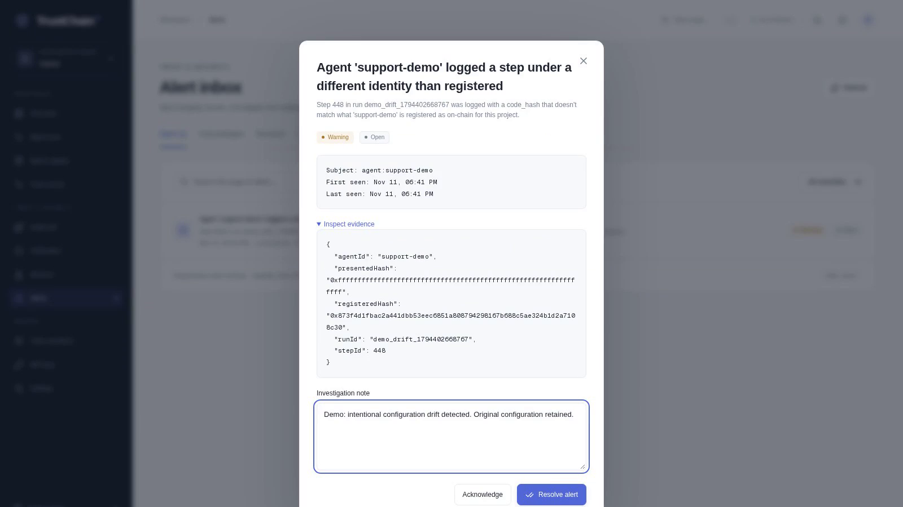 |

| Audit trail | Revoked integration access |
|---|---|
| 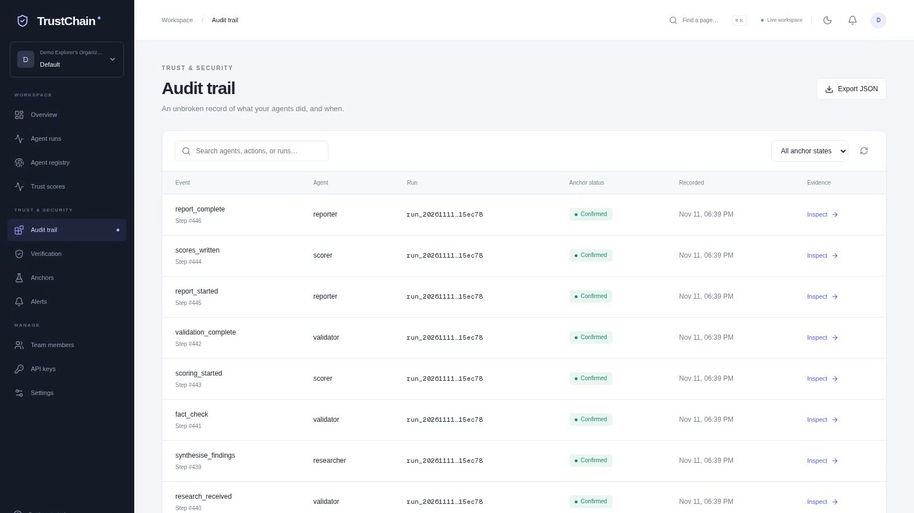 | 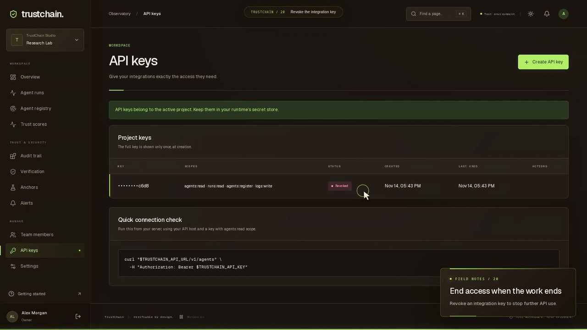 |

</details>

<details>
<summary><b>See the landing interactions and mobile layouts</b></summary>
<br>

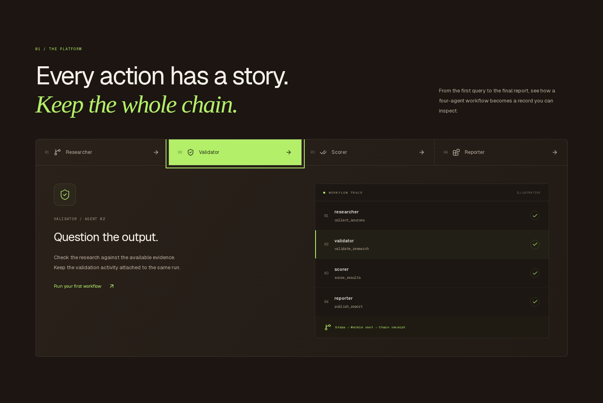

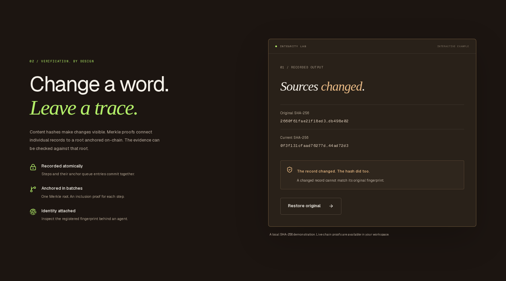

| Mobile overview | Mobile verification |
|---|---|
| 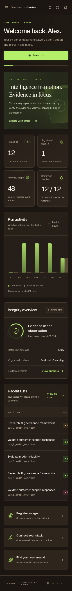 | 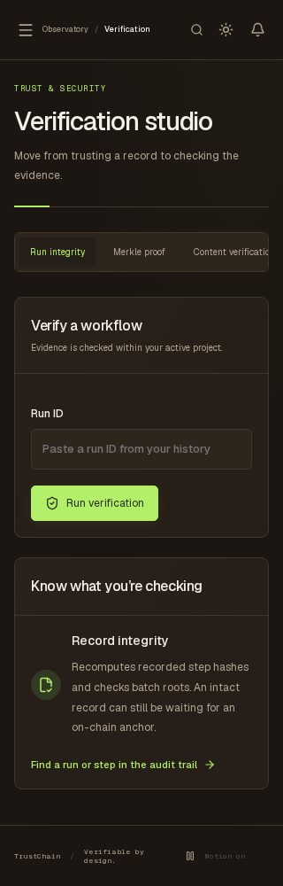 |

The public landing screenshots show its actual interactions. These two mobile screenshots use **explicit API fixtures** for repeatable layout inspection; the video and product gallery above use real services and recorded results. Real-data mobile evidence pages were also exercised separately in Playwright.

</details>

---

## How it works

### 01 / Execute and observe

| Agent | Responsibility | Observable result |
|---|---|---|
| **Researcher** | Search through MCP and synthesize findings | Recorded research activity and original tool source URLs |
| **Validator** | Extract claims, call the fact-check tool, and assess research | Validation output and recorded verification activity |
| **Scorer** | Evaluate agent performance and write scores through V2 contracts | Indexed scores and observed run counts |
| **Reporter** | Combine research, validation, and scoring | A saved report with source links and accurate anchoring language |

The browser follows a signed SSE stream. Redis transports live run events; PostgreSQL persists the run and its steps. A completed report can be reopened without keeping the original stream alive. Source URLs travel separately through the pipeline state, so a model summary cannot silently discard the original search citations.

### 02 / Record, then anchor

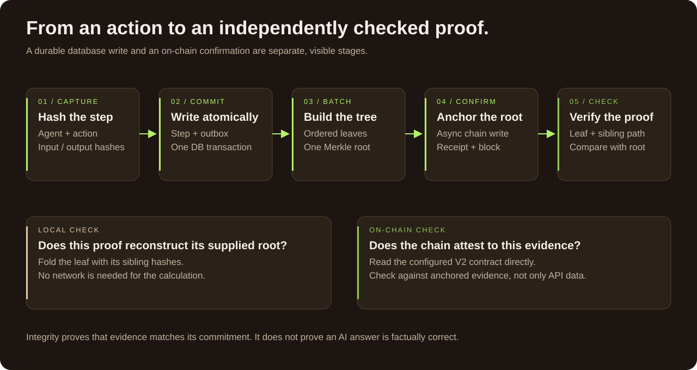

Each step and its `anchor_outbox` row commit in the **same database transaction**. The anchor worker later claims pending work, builds a Merkle batch, submits its root, and tracks confirmation. A chain outage can leave evidence pending without losing the durable intent to anchor it.

**Recorded and confirmed are separate states.** The UI and final report distinguish persisted actions, queued anchoring, and confirmed receipts. They do not assume that a database write has already become a confirmed chain transaction.

### 03 / Check the evidence


| Check | Question | Evidence used |
|---|---|---|
| **Content verification** | Does the supplied text match the recorded input/output hash? | Candidate content and the recorded hash |
| **Local Merkle verification** | Does the leaf and sibling path reconstruct the supplied root? | The proof's supplied root; no network for the calculation |
| **On-chain verification** | Does the selected contract verify the proof against anchored evidence? | The independently configured chain and contract |
| **Run integrity** | Do recorded steps and available anchored evidence remain consistent? | The applicable integrity checks for the run |

Both SDKs support local proof calculation and direct on-chain checks. Reconstructing an API-supplied root is useful; reading the configured contract directly adds a check on that root's provenance.

---

## Architecture

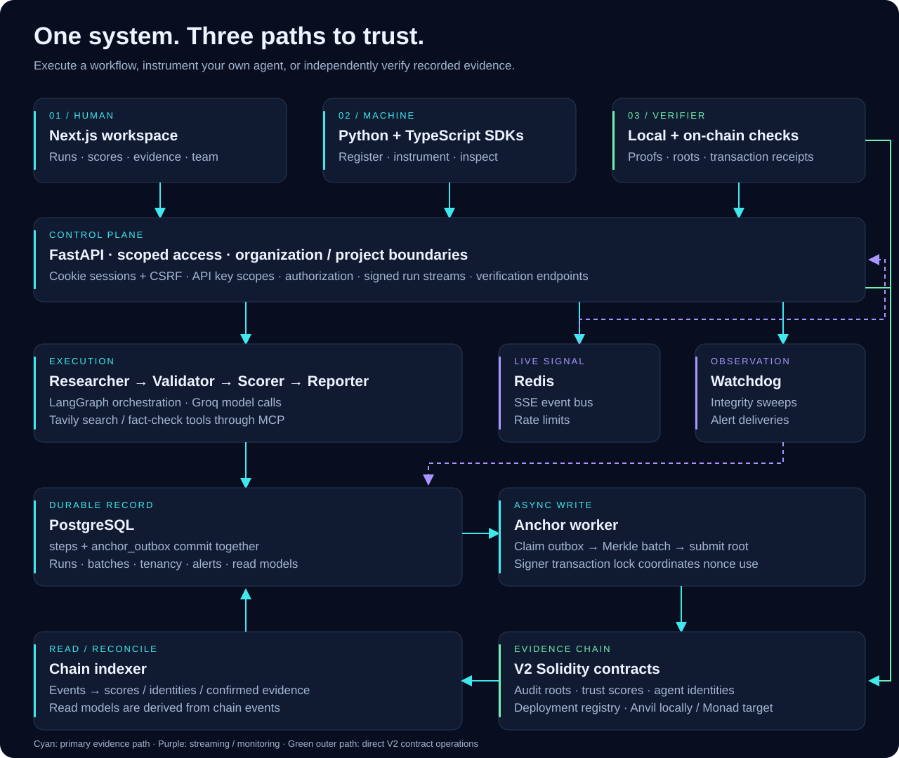

The diagram follows the primary execution, recording, anchoring, and verification paths. The [architecture document](docs/architecture.md) and [decision records](docs/adr/README.md) describe the full implementation and its tradeoffs.

| Component | Responsibility | Source |
|---|---|---|
| **Next.js workspace** | Run orchestration UI, evidence inspection, organizations, team access, and keys | [frontend/](frontend/) |
| **FastAPI control plane** | Sessions, scoped API keys, permissions, run lifecycle, SDK ingest, verification APIs | [backend/main.py](backend/main.py) |
| **LangGraph pipeline** | Research → validation → scoring → reporting | [backend/agents/](backend/agents/) |
| **MCP tool servers** | Search/fact-check tools and blockchain tool integration | [mcp_servers/](mcp_servers/) |
| **PostgreSQL** | Runs, steps, durable outbox, batches, tenancy, alerts, read models | [models](backend/db/models.py) |
| **Redis** | Run-event transport, rate limits, and coordination | [run events](backend/run_events.py) |
| **Anchor worker** | Claim work, batch leaves, submit roots, track confirmation | [backend/anchor_worker/](backend/anchor_worker/) |
| **Chain indexer** | Consume contract events and reconcile derived application state | [backend/indexer/](backend/indexer/) |
| **Integrity watchdog** | Recheck evidence, detect liveness problems, and drain alert delivery | [backend/integrity_watchdog/](backend/integrity_watchdog/) |
| **V2 contracts** | Audit roots, agent scores, agent identities, deployment resolution | [contracts/src/v2/](contracts/src/v2/) |
| **SDKs + CLI** | Instrument external agents and inspect the same evidence system | [sdk/](sdk/) |

<details>
<summary><b>Why the storage and chain paths are separate</b></summary>
<br>

- A **transactional outbox** makes recording a step and recording its anchoring intent one atomic write. [ADR 0001](docs/adr/0001-transactional-outbox-for-anchoring.md)
- **Merkle batches** anchor many leaves under one root instead of issuing one chain transaction per step. [ADR 0002](docs/adr/0002-merkle-batching-not-per-step-anchoring.md)
- **Read models** derive scores and identities from contract events; the indexer also reconciles anchoring crash windows.
- **Signer coordination** serializes nonce allocation through confirmation across API identity writes, score writes, and batch submissions. [Transaction lock](backend/blockchain/transaction_lock.py)
- **V2 deployment resolution** keeps the configured contract generation explicit. The V1 helpers remain legacy paths, not the primary evidence-write pipeline. [ADR 0003](docs/adr/0003-v1-to-v2-contract-migration-strategy.md)

</details>

---

## When an identity changes

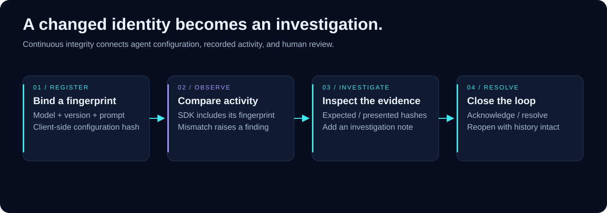

A model, version, and system prompt define a configuration fingerprint. The SDK computes that fingerprint client-side; the raw system prompt is not sent as the registration payload. When activity includes a fingerprint, the backend can compare it with the registered identity and raise a finding on mismatch.

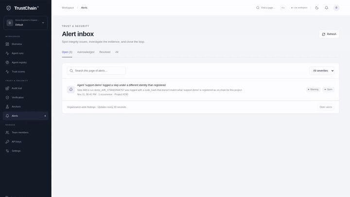

The new tour follows the actual investigation flow: a changed fingerprint was supplied through the SDK, the backend produced a finding, and the UI exposed its evidence for review and resolution.

| Signal | Detection path |
|---|---|
| **A different fingerprint accompanies a step** | Synchronous identity-drift check on SDK ingest |
| **An identity is updated or revoked** | Indexed contract events produce identity findings |
| **A stored step no longer matches its leaf hash** | Watchdog row verification |
| **Leaves, a batch root, or anchored evidence diverge** | Merkle reconstruction and configured chain checks |
| **Anchoring stalls or work is dead-lettered** | Outbox liveness checks |

Findings support acknowledgment, resolution notes, reopening, and eligible notification delivery. An alert is evidence for investigation; an identity update may be intentional and still deserve review.

---

## Instrument your own agent

You can keep your agent in its existing application. TrustChain’s instrumentation surface is separate from its built-in pipeline.

First create a verified account, open **API keys**, and issue a project-scoped key. Agent registration needs `agents:register`, logging needs `logs:write`, and evidence reads need the applicable read scopes. Scope details live in the [SDK documentation](sdk/python/README.md).

### Python

Install from this checkout:

```bash
python -m pip install -e ./sdk/python
```

```python
import os
from trustchain_sdk import TrustChain

with TrustChain(
    api_key=os.environ["TRUSTCHAIN_API_KEY"],
    base_url="http://localhost:8000",
    on_error="raise",
) as tc:
    tc.register_agent(
        agent_id="support-bot",
        model="your-model",
        version="1.0.0",
        system_prompt="Answer support questions carefully.",
    )

    receipt = tc.log_and_wait(
        agent_id="support-bot",
        action="answer_customer",
        input="How can an audit log be verified?",
        output="Reconstruct its Merkle proof and check the anchored root.",
    )
    print(receipt.step_id, receipt.anchor_status)
```

The receipt confirms ingestion. Poll for the proof after anchoring; a newly recorded step can still be pending.

### TypeScript

Build the local package and install it into your application using its checkout path:

```bash
npm --prefix sdk/typescript ci
npm --prefix sdk/typescript run build
# In your application: npm install /absolute/path/to/TrustChain/sdk/typescript
```

```ts
import { TrustChain } from "trustchain-sdk";

const tc = new TrustChain(process.env.TRUSTCHAIN_API_KEY!, {
  baseUrl: "http://localhost:8000",
  onError: "raise",
});

await tc.registerAgent({
  agentId: "support-bot",
  model: "your-model",
  version: "1.0.0",
  systemPrompt: "Answer support questions carefully.",
});

const receipt = await tc.logAndWait({
  agentId: "support-bot",
  action: "answer_customer",
  input: "How can an audit log be verified?",
  output: "Reconstruct its Merkle proof and check the anchored root.",
});

console.log(receipt.stepId, receipt.anchorStatus);
await tc.close();
```

Both SDKs also provide non-blocking logging, decorators/wrappers, optional LangChain integration, typed API errors, local proof checks, and optional direct on-chain verification. Their default instrumentation behavior warns and fails open; these examples opt into exceptions so integration failures are visible.

[Python SDK guide](sdk/python/README.md) · [TypeScript SDK guide](sdk/typescript/README.md) · [CLI guide](sdk/python-cli/README.md) · [Runnable support-agent example](examples/support_agent/README.md)

---

## Run locally

**Prerequisites:** Git with contract submodules, Docker/Compose running, Python with a virtual environment, Node.js/npm, and Foundry (`forge`). CI runtime versions are defined in the [test workflow](.github/workflows/test.yml); the latest local validation used Python 3.14 and Node 26.

```bash
git clone --recurse-submodules https://github.com/nipunkalsotra/TrustChain.git
cd TrustChain

python3 -m venv .venv
source .venv/bin/activate
python -m pip install -r backend/requirements-dev.txt
npm --prefix frontend ci

cp backend/.env.example backend/.env
cp frontend/.env.example frontend/.env.local
```

Set these values in `backend/.env` before starting:

| Variable | Local purpose |
|---|---|
| `GROQ_API_KEY` | Real model calls; the built-in pipeline requires a configured provider |
| `GROQ_MODEL` | Model selection; defaults to `openai/gpt-oss-120b` and also drives agent identity hashing |
| `TAVILY_API_KEY` | Web search and fact-check tools |
| `JWT_SECRET` | A strong generated session-signing secret |
| `COOKIE_SECURE=false` | Local HTTP browser sessions; use secure cookies for HTTPS deployments |
| `FRONTEND_URL=http://localhost:3000` | Browser origin and email-link base |
| `EMAIL_BACKEND=console` | Capture verification/invitation/reset emails locally |

Generate the signing secret locally:

```bash
python3 -c 'import secrets; print(secrets.token_hex(32))'
```

Start the application:

```bash
./start.sh
```

The launcher starts PostgreSQL, Redis, and Anvil through Compose; applies migrations; deploys local V2 contracts when needed; and starts the API, MCP servers, anchor worker, indexer, watchdog, and frontend. It uses Anvil’s public development key for local V2 writes. A real wallet key is not needed for this local V2 workflow; legacy V1 features have separate configuration.

| Open | Address |
|---|---|
| **Workspace** | <http://localhost:3000> |
| **API reference** | <http://localhost:8000/docs> |
| **Readiness** | <http://localhost:8000/ready> |
| **Service logs** | `.logs/` |

Sign up, open the verification link from the console email in the API log, and create a project key if you want to connect an SDK. Use Ctrl+C to stop launcher-managed processes; the Compose infrastructure remains available.

For existing clones, initialize dependencies with `git submodule update --init --recursive`. If another local stack already owns these ports, stop that stack or configure an isolated environment before starting this one.

Full configuration: [backend example](backend/.env.example) · [deployment modes](docs/deployment-modes.md) · [operator runbooks](docs/runbooks.md)

---

## Verified against the running system

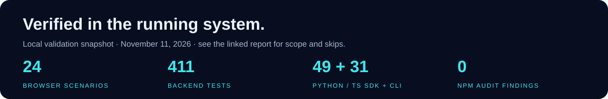

The **November 14, 2026** redesign was checked against the production frontend build, real local services, and explicit UI fixtures. These are dated results, not live CI badges.

| Check | Latest redesign result |
|---|---|
| Playwright UI, landing, responsive layouts, and secondary controls | **12 passed** |
| Playwright real-service audit | **13 passed** |
| Playwright real-backend smoke checks | **4 passed** |
| Playwright full model/search/chain pipeline | **1 passed** |
| **Distinct browser scenarios** | **30 passed**, 0 failed or skipped on their latest applicable runs |
| Frontend unit tests | **20 passed** |
| Search-source and final-report regressions | **7 passed** |
| Production build, TypeScript, ESLint, whitespace checks | **Passed** |
| Silent video validation | **325.7 seconds · 1920×1080 · 30 fps · H.264 · no audio · fast-start** |

The production browser run initially passed 28/29. Its citation failure revealed that model synthesis could drop source URLs. Original search URLs now travel separately through the pipeline and into the report; the affected full pipeline passed a focused rerun. A supplemental controls scenario also passed. **The count uses the latest result for each unique scenario, rather than counting retries as extra tests.**

The final pipeline verification produced a 2,128-character report, confirmed all 10 steps on Anvil, passed run integrity checks, retrieved a confirmed proof, and reopened its saved report. The separate demo recording also completed its real workflow and proved that its revoked key receives HTTP 401.

[Final report PDF](artifacts/redesign/TrustChain-Redesign-Final-Report.pdf) · [Detailed report and limits](artifacts/redesign/final-report.md) · [30-scenario result register](artifacts/redesign/verification-results.json) · [Recording manifest](artifacts/redesign/tour-recording-manifest.json)

<details>
<summary><b>Earlier full-system baseline — November 11, 2026</b></summary>
<br>

These broader backend, SDK, contract, and dependency results are retained as historical evidence. They were **not all rerun during the frontend redesign**.

| Layer | Earlier recorded result |
|---|---|
| Backend | 411 passed, 3 documented skips |
| Python SDK + CLI | 49 passed |
| TypeScript SDK | 31 passed |
| Contract suite | Passed |
| Frontend dependency audit | 0 findings at that validation time |

[November 11 completion report](docs/completion-report-2026-11-11.md) · [Historical structured results](docs/audits/2026-11-11/final/results.json) · [Historical dependency audit](docs/audits/2026-11-11/final/npm-audit.json)

</details>

<details>
<summary><b>Reproduce the checks and cinematic tour</b></summary>
<br>

```bash
# Frontend build and static/unit checks.
npm --prefix frontend run lint
npm --prefix frontend test
npm --prefix frontend run build

# Repeatable UI checks with explicit API fixtures.
(cd frontend && npx playwright test e2e/product.spec.ts e2e/redesign.spec.ts)

# Real-service account/workspace checks; needs the running local API.
(cd frontend && npx playwright test e2e/smoke.spec.ts)

# Complete research pipeline with real model/search and chain services.
(cd frontend && TRUSTCHAIN_FULL_PIPELINE=1 npx playwright test e2e/pipeline.spec.ts)

# Expanded audit: isolated local stack and console email backend required.
(cd frontend && TRUSTCHAIN_AUDIT=1 \
  TRUSTCHAIN_AUDIT_EMAIL_LOG=/absolute/path/to/console-api.log \
  npx playwright test e2e/audit.spec.ts --workers=1)

# Focused source/report regressions; use a separate test database.
(cd backend && ../.venv/bin/python -m pytest \
  tests/test_reporter_output.py tests/test_researcher_sources.py -q)
```

Run suites sequentially, or assign separate `--output` directories. Model-heavy suites should run separately to avoid competing for provider quota. See the [browser testing guide](frontend/e2e/README.md) for setup and the [tour reproduction guide](artifacts/redesign/README.md) for recording/encoding commands.

To regenerate this README's screenshots, animations, and matching SVG diagrams from the verified local MP4:

```bash
.venv/bin/python scripts/render_readme.py
```

Broader backend, SDK, and contract commands remain in the [completion report](docs/completion-report-2026-11-11.md) and each package's documentation.

</details>

---

## Access, privacy, and operating boundaries

| Control | Implementation |
|---|---|
| **Organization and project isolation** | Application authorization plus PostgreSQL row-level security when using the restricted API role |
| **Human sessions** | HttpOnly session cookies, CSRF checks, refresh, and verification/recovery flows |
| **Machine access** | Project-scoped API keys with explicit scopes and revocation |
| **Team permissions** | Viewer, member, admin, and owner roles |
| **Configuration privacy** | SDK registration sends a client-computed configuration hash rather than the raw system prompt |
| **On-chain evidence** | Merkle roots and contract metadata rather than raw input/output content |
| **Signing custody** | Local development signer and optional KMS/Vault backends |
| **Evidence monitoring** | Step, batch-root, identity-event, and anchoring-liveness checks |

The redesigned application was verified locally: Anvil, console email, and real external model/search services. Production TLS/cookies, external email delivery, public-chain reliability, optional evidence publishing, and other browser engines require their own deployment validation. Model-provider rate limits still apply. A recorded commitment cannot establish that an agent’s real-world statement is correct, or that every action outside instrumentation was captured.

Use the production deployment configuration for public hosting; the local Compose defaults and Anvil development key are for development. [Threat model](docs/threat-model.md) · [Deployment modes](docs/deployment-modes.md) · [Multisig handoff](docs/multisig-admin-handoff.md)

---

## Explore the code

```text
TrustChain/
├── frontend/
│   ├── components/marketing/  Landing story, pipeline explorer, SHA-256 example
│   ├── components/dashboard/ Workspace shell and responsive navigation
│   ├── components/product/   Runs, identities, evidence, team, and settings
│   ├── components/ui/        Shared evidence sculpture and motion control
│   └── e2e/                  UI fixtures, live workflows, and redesign checks
├── backend/
│   ├── agents/               LangGraph agents, source provenance, model/tool adapters
│   ├── db/                   Durable records, tenancy, and read models
│   ├── anchor_worker/        Outbox claims, Merkle batches, chain submission
│   ├── indexer/              Contract-event ingestion and reconciliation
│   ├── integrity_watchdog/   Continuous verification and liveness checks
│   └── notifications/        Verification, recovery, invitations, alerts
├── contracts/                Solidity contracts, deployments, Foundry tests
├── mcp_servers/              Search and blockchain tool servers
├── sdk/                      Python, TypeScript, and Python CLI packages
├── examples/                 External-agent integration example
├── docs/                     Architecture, decisions, runbooks, earlier validation
├── artifacts/redesign/       New cinematic tour, report, test results, screenshots
├── scripts/                  Recording, encoding, report, and README media generators
└── assets/readme/            Matching SVG diagrams and new-tour excerpts
```

[Architecture](docs/architecture.md) · [Design decisions](docs/adr/README.md) · [End-to-end walkthrough](docs/e2e-walkthrough.md) · [API compatibility policy](docs/api-deprecation-policy.md) · [Release process](docs/release-process.md)

<div align="center">

**Your agents. Your evidence. Your confidence.**

[Watch the new film](https://drive.google.com/file/d/1sM2GhKTrmnHkojWA4kJU5ybNCBuHza0F/view?usp=sharing) · [Read the redesign report](artifacts/redesign/final-report.md) · [MIT licensed](LICENSE) · [Back to the top](#intelligence-with-a-proof)

</div>
